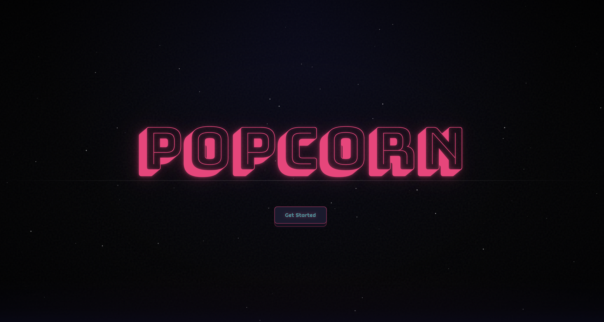

# Popcorn

Popcorn is a film and TV diary styled like a retro drive-in cinema. I love films and I wanted somewhere to track what I've watched that actually felt fun to use. Not just another generic list app, but something with personality that I'd enjoy coming back to.



**Try it live at [popcorn.tyrion.uk](https://popcorn.tyrion.uk)**

I designed and built it on my own, across more than 500 commits. It scored 100 for Accessibility and 100 for SEO on Google Lighthouse when I tested it on 28 September 2026.

## What you can do

- Log a watch with a star rating, a review and who you watched it with, then choose whether it's public, visible to the people you watched with, or private.
- Track TV shows episode by episode, rewatches included, and keep journal entries for a whole show, a season or a single episode.
- Build as many watchlists as you like and invite friends to share one with you.
- Shuffle through a stack of swipeable cards picked from your taste profile, trending titles and new discoveries. On a shared watchlist, anything everyone swipes yes on becomes a match and goes straight onto the list.
- Add friends, see what they've been watching in your feed, send them recommendations and compare achievements on their profile.
- Unlock 45 achievements for things like watching, reviewing, tracking shows and making friends.
- Open any film or show to get the cast, a trailer that plays on a drive-in screen, a quote from Wikiquote and a link to content warnings on Does The Dog Die.
- Set a reminder to review something later, and get notifications for friend requests, recommendations and matches.
- Sign in without a password using a magic link sent to your email. New accounts go through an onboarding flow that sets up your taste profile, favourite film, favourite genre and bio.

## Built with

- TypeScript, React 19 and [TanStack Start](https://tanstack.com/start) (Router and Query)
- tRPC for the API
- PostgreSQL with Drizzle ORM (21 tables)
- Better Auth with the magic link plugin
- Tailwind CSS 4, shadcn/ui and Motion
- [TMDB](https://www.themoviedb.org/) for film and TV data
- Resend and React Email for emails, UploadThing for avatar uploads
- Vitest for tests and Biome for linting and formatting
- Docker, deployed with Coolify

GitHub Actions runs Biome, a type check, a production build and the tests on every pull request.

## Running it locally

You'll need [Bun](https://bun.sh) and Docker (or your own PostgreSQL database).

```bash
bun install
cp .env.example .env
docker compose up -d     # starts PostgreSQL 17 on port 5432
bun run db:migrate
bun run dev
```

The app runs at http://localhost:3000.

Fill in these variables in `.env` first:

- `DATABASE_URL`
- `BETTER_AUTH_URL` and `BETTER_AUTH_SECRET`
- `RESEND_API_KEY` and `RESEND_FROM_EMAIL`
- `UPLOADTHING_TOKEN`
- `TMDB_READ_ACCESS_TOKEN`
- `CRON_SECRET`, which protects the review reminder endpoint

Other useful scripts:

```bash
bun run test        # Vitest
bun run check       # Biome lint and format check
bun run typecheck   # TypeScript
bun run dev:email   # preview the email templates
bun run build       # production build
```

The Dockerfile builds the app, runs the database migrations and then starts the server on port 3000.
